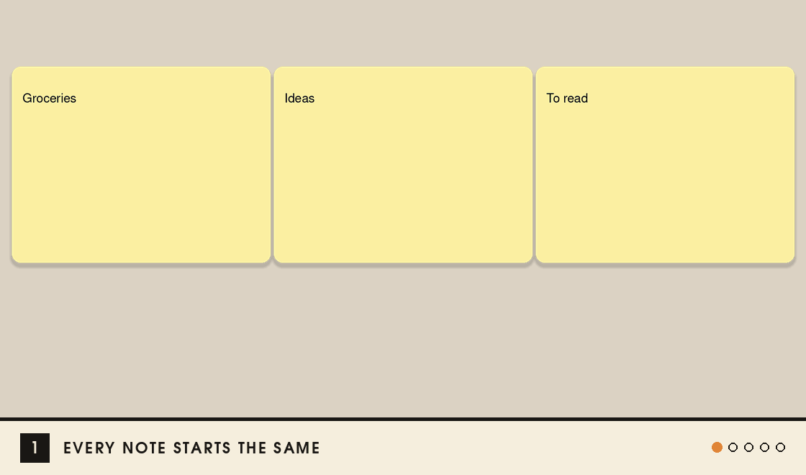
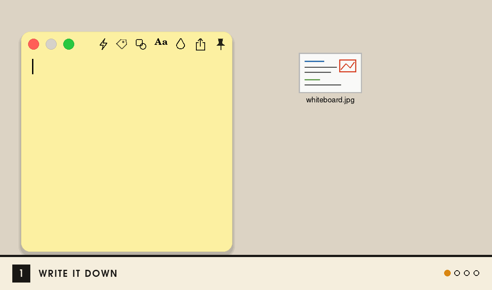
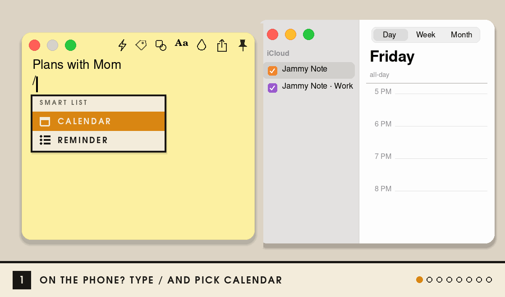
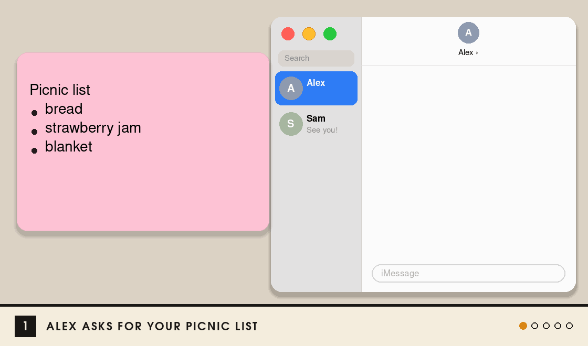
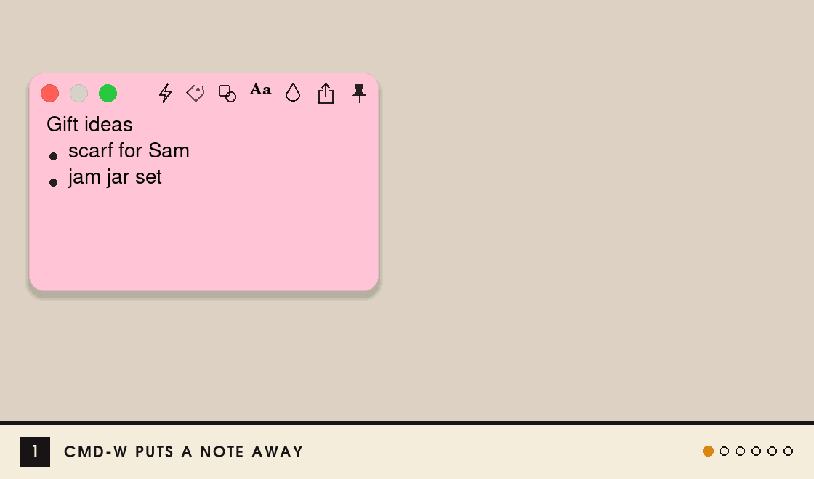

# Jammy Note

A small sticky-note app for macOS, with notes in jam colors.

**[Download the latest version](https://github.com/Dino-Boooo/jammy-note-releases/releases/latest)** · macOS 13 or later · Apple silicon and Intel

[Install](#install) · [Style a note](#style-a-note) · [Write](#write) · [Smart list](#smart-list) · [Share](#share-a-note) · [Find notes](#find-notes) · [Shortcuts](#shortcuts)

## Install

1. Download **Jammy-Note-x.y.z.zip** from the link above and open it.
2. Drag **Jammy Note** into **Applications**.
3. Open it. macOS says it can't check the app: click **Done**, then go to **System Settings ▸ Privacy & Security**, scroll down and click **Open Anyway**.

You only do this once. After that Jammy Note updates itself: a red dot shows on its menu bar icon, and **Update Now** does the rest. Your notes stay.

## How to use

### Style a note

- **Shape**: square, tomato or orange
- **Drop**: color and paper · **Aa**: font
- **Pin**: keeps the note above other windows
- Double-click a note to fold it up

### Write

- **New note**: ⌘N, or ⌃⌥N from any app
- **Format**: select text and a format bar pops up
- **Lists**: start a line with `-`, `1.` or `[]` and a space
- **Pictures**: paste or drop them in. Drag a corner to resize; the crop button on a picture trims its sides

### Smart list

Write a date on a line and it goes into Calendar or Reminders.

1. Type **/** on a line and pick **Calendar** or **Reminder**.
2. Write what it is and when: `call mom fri 6:30pm`
3. Move on to another line. It's in your calendar, and a tag under the line shows the date.

Change the line and the event changes too. Click the tag to take it out of the calendar, or put it back.

Ways to write a date

On Thursday, November 12:

| You write | The tag says |
|---|---|
| `call mom fri 6:30pm` | 11/13 FRI 6:30 PM |
| `dentist tmr 9am` | 11/13 FRI 9 AM |
| `lunch next tue 12pm` | 11/17 TUE 12 PM |
| `send report 11/20` | 11/20 FRI |
| `team meeting tonight 8` | 11/12 THU 8 PM |
| `gym nov 16 7:30` | 11/16 MON 7:30 AM |

- A time is read as written: `7:00` is the morning; write `7pm` or `19:00` for the evening.
- A time with no day (`3pm`) means the next time that comes.
- Dates written in Chinese are read too.

What the tag means

| The tag looks | It means |
|---|---|
| dashed, `CALENDAR` or `REMINDER` | No date written yet |
| dashed, with a date | Goes in when you leave the line |
| solid, with a date | In your calendar or Reminders |
| dashed, `+` and a date | Taken out. Click to put it back |

Reminders, alerts and Smart notes

- **Reminder** makes the line a checklist item. Check it off in the note or in Reminders, and the other follows.
- **Alerts**: **Calendar: alert me** in Settings sets when events alert you. The bell beside an event's tag changes it for that event. Reminders alert at their own time.
- **Smart note** (the bolt on a note, or **File ▸ New Smart Note**): every line with a date goes in, no / needed.
- **Deleting a line** removes its event, unless the event has already started.

Calendars, tags and Tidy

- Events go to a calendar named **Jammy Note**. A note with a tag, like **Work**, uses **Jammy Note · Work**, and its tags take that calendar's color.
- To use your own calendars, turn off **Jammy Note's own calendars** in Settings and pick them there.
- **Tidy dates out of the text** (Settings) moves a line's date into its tag: "Reach out Prof at 10AM 11/13" becomes "Reach out Prof". Turn it off and the dates come back.
- Jammy Note asks to use Calendar and Reminders the first time. If you said no: **System Settings ▸ Privacy & Security ▸ Calendars** (and **Reminders**).

### Share a note

1. Click a note's share button and pick **Messages**, **Mail** or **AirDrop**.
2. It arrives as a picture of the note. Anyone can look at it.
3. Someone who has Jammy Note open drags the picture onto their Desktop, and it becomes a note again.

If it stays a picture

- Drop it on the Jammy Note icon in the Dock, or on All Notes. If the note inside was lost on the way, Jammy Note reads the words in the picture and makes the note again, without its formatting.
- Pictures of your own notes stay pictures on your Desktop, so you don't get a second copy.

### Find notes

- **All Notes** (⌘F): every note, open or closed. Search, or filter by tag.
- **Closing** a note (⌘W) only puts it away. ⇧⌘T reopens it.
- **Deleted** notes wait in Trash for 30 days.

### Shortcuts

| | |
|---|---|
| New note | ⌘N · ⌃⌥N from any app |
| All Notes | ⌘F · ⌃⌥F from any app |
| Hide or show all notes | ⌃⌥H |
| Settings | ⌘, |
| Every shortcut | ⌘/ |

Everything saves by itself. Ideas or bugs? **Send Feedback…** in the menu bar icon's menu reaches the jam maker.
